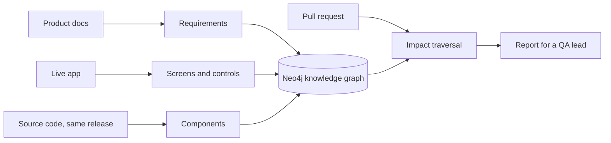

# Triangulate

**An intelligence layer beneath agentic testing.** Triangulate crawls a live web app, ingests its public product
docs and maps its source code, joins all three in one Neo4j knowledge graph, and then, for a real pull request,
reports the **blast radius**: which screens and controls are at risk, which user journeys to retest, and which
documented requirements lose or risk coverage. The report is written for a QA lead who knows the product but
not the code.

Target: **[Hoppscotch](https://hoppscotch.io)**, an open-source API client. The live app, the code repository
`hoppscotch/hoppscotch` (pinned to the release that is live, 2026.9.0) and the docs repository `hoppscotch/docs`
are all public.

## Contents

1. [Documentation](#1-documentation)
2. [Results at a glance](#2-results-at-a-glance)
3. [How it works](#3-how-it-works)
4. [Quick start](#4-quick-start)
5. [Command reference](#5-command-reference)
6. [Reproducibility and the LLM cache](#6-reproducibility-and-the-llm-cache)
7. [Exploring the graph](#7-exploring-the-graph)
8. [Configuration](#8-configuration)
9. [Repository layout](#9-repository-layout)
10. [Known limitations](#10-known-limitations)
11. [Assignment deliverables](#11-assignment-deliverables)

---

## 1. Documentation

| Document | What it is |
|---|---|
| [`docs/DESIGN.pdf`](docs/DESIGN.pdf) | **Design document** (11 pages): agent decomposition, graph schema, modelling absence, confidence and human-in-the-loop, eval, measured results, scope decisions, "with another week". Source: [`docs/DESIGN.md`](docs/DESIGN.md), rebuilt with `.venv/bin/python docs/build_pdf.py` |
| [`docs/how-it-works.html`](docs/how-it-works.html) | Plain-language overview with flow diagrams (open in a browser) |
| [`docs/run-and-test.html`](docs/run-and-test.html) | Hands-on guide: run each stage, inspect its output, explore the relations in Neo4j, analyse a PR, check the scorecard |
| [`docs/RUN_STATS.md`](docs/RUN_STATS.md) | What every number a stage prints means (`proposed`, `kept`, `rejected`, `states`, `mapped`, …), with the real run's values |
| [`samples/`](samples/) | Reports for five real PRs (`report.html`, `report.md`, `impact.json`) and `run-summary.json`. Start with [`samples/pr-6706/report.html`](samples/pr-6706/report.html) |
| [`PLAN.html`](PLAN.html) | The plan written and reviewed before implementation |

## 2. Results at a glance

Real run `20261016T065647Z-default` (full numbers in DESIGN §7):

| | |
|---|---|
| Built | 116 verified requirements from 26 doc pages; 243 UI states, 1,044 controls, 524 transitions; 335 components |
| Linked | 70% of controls linked to a component (route-unique links 100% correct on the gold set); 81% of web-testable requirements covered by observed UI; 112 user journeys, all replay-verified |
| Absence | every uncovered requirement carries one typed gap: 19 built but not reached, 12 need sign-in, 2 not web UI |
| Accuracy | DOM→code precision 0.69 overall (1.00 route-unique); requirement→UI precision 0.84, recall 0.76 |
| PR reports | 5 real PRs, no false alarms against hand-written expectations; 3 of 5 expected controls found for the one PR whose UI the crawl reached |
| Reproducible | a fresh copy of this repository, installed from this README, rebuilt the real run offline: every stage hash identical, 0 LLM calls, all five sample reports byte-identical, eval verdict "run is correct" |
| Tests | 38 (unit + Neo4j integration) |

## 3. How it works



The key bridge from UI to code is factual, not guessed: Hoppscotch renders every label through a translation
key (`t('key')`), so a visible label points to its key, the key to the components that use it, and the route's
render tree decides between them. Anything code can decide is decided by code; the LLM (Gemini) is used only where
language understanding is needed, and its output is always checked by code.

| Stage | What it does | Decides |
|---|---|---|
| `pin` | reads the live app's version, checks out that git tag and the docs commit | code |
| `ingest` | docs → atomic requirements with verbatim, verified quotes | LLM proposes, code verifies |
| `code` | Vue + TS compilers → components, render tree, routes, imports, i18n usage | code |
| `crawl` | systematic Playwright explorer → states, controls, transitions, screenshots | code |
| `label` | human-readable screen names | LLM (readability only) |
| `load` | builds the graph so retrieval can use Neo4j full-text indexes | code |
| `domcode` | control → i18n key → component, disambiguated by the route's render tree | code |
| `judge` | requirement → controls and → components (retrieve, then judge) | LLM, validated by code |
| `probe` | bounded LLM agent hunts in the live app for requirements the crawl missed | LLM agent, guarded by code |
| `probe_post` | labels, links and re-judges what the probe found | mixed |
| `gaps` | explains every uncovered requirement with a typed gap | code |
| `flows` | shortest recorded path to each requirement's evidence, replayed to prove it | code (+ LLM names) |
| `review` | collects open questions for a human | code |
| `final_load` | rebuilds Neo4j from artifacts, records stage hashes | code |

## 4. Quick start

### Prerequisites

| Tool | Version | Notes |
|---|---|---|
| Python | 3.12 | managed by `uv` (`brew install uv`) |
| Node.js | 20+ | runs the Vue/TypeScript extractor |
| Neo4j | 5.x or later | any local instance; Triangulate only deletes its own node types; APOC not required |
| Gemini API key | optional | only for live runs; offline runs replay the recorded answers |
| `jq` | any | only for the inspection commands in the hands-on guide |

### Install and configure

```bash
uv venv --python 3.12 .venv
uv pip install --python .venv/bin/python -e ".[dev]"
.venv/bin/python -m playwright install chromium
npm install --prefix src/triangulate/code/node
cp .env.example .env    # fill in the Neo4j user/password (and GEMINI_API_KEY for live runs)
.venv/bin/python -m pytest -q
```

### Reproduce the real run (offline, no API key needed, about 35 minutes)

```bash
.venv/bin/triangulate run --offline                     # all 14 stages; most of the time is the crawl
.venv/bin/triangulate reason 6706 --offline             # -> runs/latest/reason/pr-6706/report.html
for pr in 6584 6707 6708 6721; do .venv/bin/triangulate reason $pr --offline; done
.venv/bin/triangulate eval                              # prints the scorecard and "run is correct"
```

Each run writes everything it produces to `runs/<run_id>/` (`runs/latest` points at the newest) and rebuilds the
graph in Neo4j from those files. To go stage by stage and inspect each layer, follow
[`docs/run-and-test.html`](docs/run-and-test.html).

## 5. Command reference

All commands are `.venv/bin/triangulate <command>`.

| Command | What it does |
|---|---|
| `run [--offline] [--profile smoke]` | builds a new run (all stages) |
| `run --until <stage>` | stops after a stage |
| `run --run <id> --start <stage> [--until <stage>]` | resumes an existing run from a stage |
| `reason <pr> [--offline] [--strict]` | blast-radius report for a PR; `--strict` exits non-zero while questions for a human are open |
| `eval [--run <id>] [--compare <id>] [--update-calibration]` | invariants, gold-set scores and a correct/incorrect verdict; compares stage hashes with other runs; optionally adopts the measured link precision as next run's confidence |
| `load --run <id>` | rebuilds the Neo4j graph from a run's files |
| `review` | answer open questions; saved to `config/overrides.yaml` and reused by later runs |
| `export --run <id>` | copies a run's reports and summary into `samples/` |

A run is **correct** when all 10 invariants pass and its gold-set scores meet `eval/thresholds.yaml`.

## 6. Reproducibility and the LLM cache

- Every LLM response is cached in `cache/llm/` by a hash of the full request, and GitHub responses in
  `cache/github/`; both are committed. With `--offline` a cache miss is an error, never a silent call.
- Every stage writes hashed artifacts. Screenshots and on-screen coordinates are excluded from the hashes because
  pixels are not deterministic.
- `eval/calibration.json` holds the link confidences the recorded run used (also stored in each run's
  `manifest.json` as `link_priors`); `eval` only rewrites it with `--update-calibration`, so replays stay exact.
- Run crawls one at a time: the MQTT page connects to a public broker with the app's default client id, which
  every Hoppscotch user shares.
- Live runs: each task family is pinned to one model in `config/target.yaml` (no runtime switching). A run from an
  empty cache needs about 15 calls; the Gemini free tier allows about 20 per model per day. When the daily quota
  is exhausted the run stops with a clear message and resumes later with `run --run <id> --start <stage>`.

## 7. Exploring the graph

Open Neo4j Browser (http://localhost:7474) and try:

```cypher
// What a requirement is covered by, and how
MATCH (r:Requirement)-[c:COVERED_BY]->(e:Element)<-[:CONTAINS]-(s:State)
RETURN r.statement, e.label, s.label, c.method, c.confidence LIMIT 25;

// Control -> code, with evidence
MATCH (e:Element)-[i:IMPLEMENTED_BY]->(c:Component)
RETURN e.label, e.route, c.id, i.method, i.confidence, i.evidence LIMIT 25;

// Absence: documented, testable, not observed, and why
MATCH (r:Requirement)-[:HAS_GAP]->(g:Gap) OPTIONAL MATCH (g)-[:EXPECTED_IN]->(c:Component)
RETURN g.kind, r.statement, collect(c.id) ORDER BY g.kind;

// Blast radius of a PR (after `triangulate reason 6706`)
MATCH (pr:PullRequest {number: 6706})-[:CHANGES]->(f:File)<-[:DEFINED_IN]-(c:Component)<-[:IMPLEMENTED_BY]-(e:Element)
RETURN f.path, c.id, collect(DISTINCT e.label);
```

More queries, with what each one should return, are in [`docs/run-and-test.html`](docs/run-and-test.html#neo4j).

## 8. Configuration

| File | Holds |
|---|---|
| `config/target.yaml` | every setting: target app and seed routes, crawl budgets and guardrails, docs pages, LLM models per task, risk weights and bands |
| `config/profile.smoke.yaml` | overrides for the small smoke run |
| `config/overrides.yaml` | human decisions from `triangulate review` |
| `eval/gold/*.yaml` | hand-labelled gold sets (DOM→code, requirement→UI, PR expectations) |
| `eval/thresholds.yaml` | scores a run must meet to count as correct |
| `eval/calibration.json` | link confidences used by the next run |
| `.env` | Neo4j credentials, Gemini key, optional GitHub token (never committed; see `.env.example`) |

## 9. Repository layout

```
config/            settings, smoke profile, human overrides
src/triangulate/
  pin.py           stage 0: version pinning
  ingest/          docs parsing and requirement extraction
  code/            Node extractor (real Vue + TS compilers) and code graph
  crawl/           observer script, guarded browser session, explorer, screen labels, probe agent
  link/            DOM->code, requirement judge, gaps, flows
  graph/           Neo4j schema and loaders
  reason/          GitHub client, diff -> changes, impact traversal, report writer and validator
  llm/             Gemini client (cache, budget, rate limit), schema conversion
  eval/            invariants, gold-set metrics, verdict, calibration, repeatability
eval/              gold sets, thresholds, calibration
cache/             recorded LLM and GitHub responses (makes runs replayable)
docs/              DESIGN.pdf (+ DESIGN.md source, build_pdf.py), how-it-works.html, run-and-test.html
samples/           reports for five real PRs and run-summary.json
tests/             pytest suite
runs/              run folders (not committed)
```

## 10. Known limitations

Measured, not hypothetical (details in DESIGN §10):

- The crawl is signed out, so sign-in-only features are recorded as gaps rather than observed.
- Controls whose text is not a translated string (about 30%) cannot be linked to code; they are listed as unmapped.
- Element identity can merge two look-alike controls on the same page.
- The probe agent was capped by the free-tier quota (one requirement per run).
- The PR evaluation set is small (5 PRs) and was not held out.
- The MQTT page shares a public broker with every Hoppscotch user, so crawls must not run in parallel.

## 11. Assignment deliverables

| Asked for | Where |
|---|---|
| Crawl a live public app with a browser agent | `src/triangulate/crawl/` (systematic explorer + bounded LLM probe agent); 243 states of hoppscotch.io |
| Ingest a public spec / PRD | `src/triangulate/ingest/`; 116 requirements with verified quotes from `hoppscotch/docs` |
| Knowledge graph of Requirements, DOM/UI and Code, modelling absence | `src/triangulate/graph/`, schema in DESIGN §3, absence as typed `Gap` nodes in DESIGN §4 |
| Blast-radius report for a real PR, readable by non-engineers | `src/triangulate/reason/`; [`samples/pr-6706/report.html`](samples/pr-6706/report.html) and four more |
| Runnable README | this file, verified on a fresh copy |
| Design document, 8–12 pages | [`docs/DESIGN.pdf`](docs/DESIGN.pdf) |
| Sample report for a real PR | [`samples/`](samples/) |
