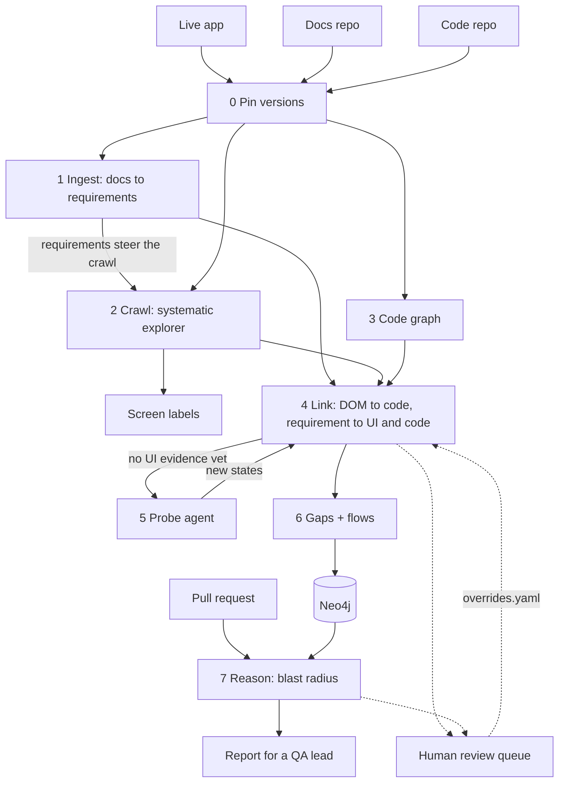
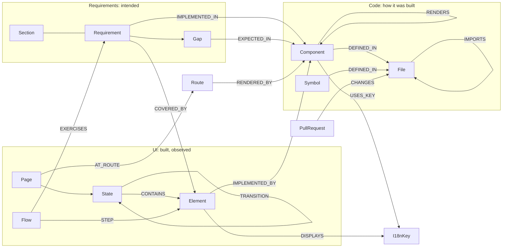
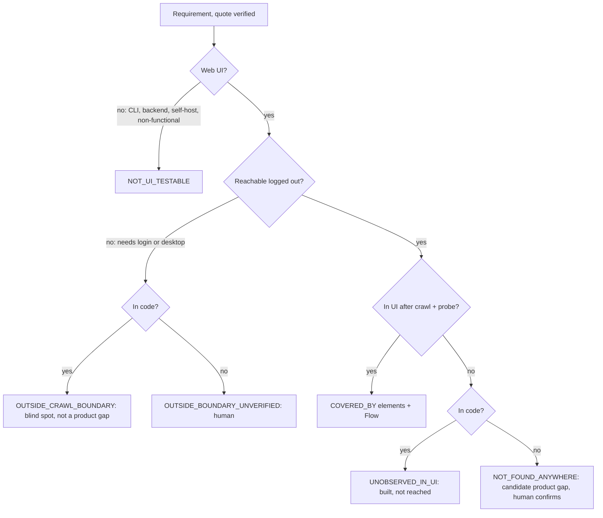

# Triangulate: design document

*Requirements × live UI × code, joined in one Neo4j graph, used to explain what a pull request puts at risk.*

Target: **Hoppscotch** (open-source API client). The live app `hoppscotch.io`, the code repository
`hoppscotch/hoppscotch` and the docs repository `hoppscotch/docs` are all public. Every number in this
document was measured by the system described here; the run ids are in the [Results](#7-results) section.

---

## 0. Summary

Triangulate is an agent that (1) explores a live web app systematically, (2) turns its product docs into
verified, testable requirements, (3) maps the app's source code at the exact release that is live, (4) links
the three in Neo4j, and (5) reports the blast radius of a real PR in language a QA lead can act on.

What I invested in, in order:

1. **A factual bridge from DOM to code.** Hoppscotch renders every UI string through `t('key')`. A visible
   label therefore points to an i18n key, and the key points to the components that call `t()` with it.
   Ambiguity (213 of 1,903 distinct strings are shared by several keys, and many keys are used by many
   components) is resolved by facts the code already holds: which components can render on that route, and
   which candidate also owns the labels next to the element on screen. No LLM is involved.
2. **Reproducibility.** Every LLM response is cached by request hash and every stage writes hashed artifacts,
   so a run can be replayed offline with zero API calls. Measured on the full profile: a fresh offline run
   reproduced every stage hash of the real run (§7.3).
3. **Absence as evidence.** Every requirement is either covered by observed UI or carries exactly one typed
   `Gap` that says why not, tied to the crawl run that asserts it.
4. **Honest confidence.** Link confidence comes from measured precision of the method that produced it
   (hand-labelled gold set), not from the model's self-report.

What I scoped down: logged-out web UI only; requirements from the 26 *feature* pages of the docs; the
frontend package only on the code side; PR analysis on a static graph (no PR build).

---

## 1. Problem framing and target choice

The task is only as good as the evidence that joins the layers. Before choosing an app I wrote down what a
target must have, then checked candidates against live data:

| Requirement | Hoppscotch (verified) |
|---|---|
| Crawlable without login | 122 interactive elements on the landing screen, no password field |
| Public repo **is** the deployed code, at a known version | The live JS bundle contains `"2026.9.0"`; tag `2026.9.0` exists (commit `63273f8`) |
| Feature-level product docs | `hoppscotch/docs`: 26 feature pages (MDX) |
| A deterministic DOM↔code bridge | `locales/en.json`: 2,198 keys; components call `t('…')` |
| A flow of mid-size UI PRs | 100+ open PRs; several touch Vue components and `en.json` |

Alternatives I rejected: **Excalidraw** (most state is drawn on a `<canvas>`, so the DOM shows little; the
docs are for developers), **Grafana Play** (excellent selectors package, but the Go+TS monorepo would eat the
budget), **Plausible** (no i18n layer, so links would rest on raw text search), **Saleor dashboard** (needs a
login).

Stage 0 (`pin`) reads the version from the live bundle, checks out exactly that tag (sparse, shallow) and
records the docs commit. If the version string is missing or ambiguous, or the tag does not exist, the run
stops. The crawl re-reads the version when it ends; a change mid-crawl invalidates the run.

---

## 2. Agent decomposition



Every stage reads artifacts from `runs/<id>/` and writes its own; Neo4j is rebuilt from artifacts, never
edited in place. That boundary is what makes stages replayable and diffable (§6).

| Stage | Decides | Why this split |
|---|---|---|
| 0 Pin | code | A version is a fact; guessing it is how code and UI drift apart. |
| 1 Ingest | **LLM proposes**, code verifies | Turning prose into atomic, testable statements is language work. Proving they were not invented is code work: each requirement must quote its section verbatim (markup-insensitive) or it is rejected and logged, never repaired. |
| 2 Crawl | code | Coverage and reproducibility need a systematic search, not a model choosing clicks. |
| Labels | LLM (readability only) | Screen names for humans; never used as evidence. |
| 3 Code graph | code (real Vue + TS compilers) | Templates must be read the way the build reads them. |
| 4a/b DOM→code | code | The i18n bridge is factual; ambiguity is resolved with code facts. |
| 4c/d Requirement→UI/code | code retrieves, **LLM judges** | Retrieval is deterministic (Neo4j full-text/BM25); deciding whether a control *implements* a capability needs judgement. The judge may cite only retrieved candidates, by short ids that code maps back and validates. |
| 5 Probe | **LLM agent**, guarded by code | Reaching a buried feature needs judgement about which control leads where. The agent can only choose controls that already passed the crawler's safety filter. |
| 6 Gaps, flows | code (+ LLM names flows) | Absence rules are a decision table; every flow is replayed before it is kept. |
| 7 Reason | code traverses, **LLM writes**, code validates | Risk is graph arithmetic. The writer sees only the computed impact set, and a validator rejects any text that cites unknown ids, omits a High-risk flow or uses code jargon. |

**Why this is an agent and not a chain of prompts.** It acts in an environment (a live browser) toward a goal
(evidence for every documented capability), observes results and changes course: the crawl frontier is
re-ranked toward requirements, and requirements that still lack evidence send the probe agent back into the
app before anything is declared missing. It has memory that compounds (the graph and the human decisions in
`config/overrides.yaml`, replayed every run), and it knows what it does not know (typed gaps, review queue).
The LLM is called for five narrow jobs, each with a schema and a code-side check.

### 2.1 The crawler (Stage 2)

Playwright + a custom explorer. I did not use `browser-use`/Stagehand: they optimise for completing a task
with an LLM choosing each click; I needed to *enumerate a state space* with coverage, the same result every
run, and structured artifacts for the graph.

- **State identity**: a fingerprint over the route plus the sorted set of (role, accessible name, context,
  selected/expanded/checked) of every visible control and label. Numbers and editor contents are masked, so
  two visits to the same screen with different data are one state.
- **Delta exploration**: from a new state only the controls that are *new* relative to its parent are tried;
  each control is exercised once per route. This is what keeps the frontier finite.
- **Navigation by replay**: every state stores the action path that first reached it. To act from another
  state the explorer opens a fresh browser context and replays the path. Hoppscotch keeps tabs and history in
  `localStorage`, so a clean context per episode is a clean slate. Escape is tried first when an overlay is
  open.
- **Requirement-steered frontier**: candidate actions are ranked by BM25 relevance of the control's label to
  the requirements' UI cues, plus novelty.
- **Guardrails in code**: same-origin only (cross-origin navigations aborted), popups closed, dialogs
  dismissed, downloads refused, a deny-list (sign-in, delete, install, …), third-party telemetry blocked, and
  any action that changes the UI language is rejected and the browser reset.
- **Settling**: an observation is taken only when no fetch/XHR, code download or page load is in flight, no transient label
  ("Connecting", "Starting", …) is visible and the DOM has stopped changing. After a full page load it first
  waits until real controls are visible.
- **Budgets**: per-route and total state caps end the crawl (about 20 minutes for the full profile). The
  wall-clock limit (45 minutes) is only a safety net, because a crawl cut by time is not comparable with
  another crawl; every route records why it stopped (`explored`, `route_cap`, `max_states` or `time`) and the eval
  reports any route cut by time.

Things the crawler taught me (each found by a verification round, each fixed):
1. Hoppscotch's button component sets `aria-label="button"` on icon buttons; the real label lives in a tippy
   tooltip. The observer reads `element._tippy.props.content`.
2. The explorer once clicked the language picker and continued in Afrikaans, so nothing matched the English
   i18n strings. Language switching is now denied and detected.
3. Observing right after "Send" captured the in-flight request ("Cancel" visible) instead of the response.
   Settling now waits for network idle.
4. A code editor's accessible name was its content (the JSON response), which varies. Editors are named by
   their placeholder.
5. Two crawls of the same release diverged on the realtime pages: "Connect" was observed while it still read
   "Connecting" in one run and not in the other. Transient labels now block settling.
6. A menu item ("Hoppscotch Cloud") reloads the whole app; one run recorded the old page, the other the reloaded
   one. Page loads are now tracked like network requests.
7. "The app has mounted" was tested as "`#app` has a child", which the loading spinner satisfies, so one run
   recorded a blank `/settings`. Mounted now means at least three visible controls.
8. A clean install from the README, run ten hours later, diverged at state 161: after clicking "GraphQL" the
   crawler recorded the previous page, because the new route's code was still downloading (each route's code
   loads on first visit). Settling now waits for script and stylesheet downloads too.

### 2.2 The probe agent (Stage 5)

For documented, web-testable requirements with no UI evidence after linking, a bounded agent drives the
browser: each decision call returns either a short plan (1–4 actions, executed by element signature so the
plan survives re-renders, stopping at the first element that is gone) or a verdict (`found` with an element
index, or `give_up`). `found` is re-checked by the judge before it counts. The full transcript becomes
evidence on the requirement's `Gap` if nothing is found. Multi-action plans exist because the API key's free
tier allows about 20 requests per model per day (§5.4).

---

## 3. Graph schema



**Two bridge node types.** `I18nKey` and `Route` exist natively in both the UI (visible text, URL) and the code
(`t()` calls, `pages/` files). Edges through them are observations, not inferences.

**Every cross-layer edge carries its evidence**: `method`, `confidence`, `evidence` (and `run_id` via its
nodes). The report shows *why* a link exists, and the eval scores each method separately.

**Design choices, each justified by a query:**

- `Element` is identified by `route | landmark context | role | normalised name`, so the "Send" button that
  appears in 40 states is one node and a report lists it once (states point to it with `CONTAINS {bbox}`).
- `TRANSITION` is a relationship because "shortest way to reach this state" is a traversal. `Flow` is a node
  because flows are named, replay-verified and referenced by requirements.
- `RENDERS {dynamic}` includes `<component :is>` targets resolved from code: what a dynamic renderer's own
  script, or its parent's, reaches through at most two TypeScript imports (this is how the JSON response
  viewer, lazily imported from a lens definition, is known to render on `/`).

```cypher
// Q1 - blast radius: what does PR #n put at risk, through which chain?
MATCH (pr:PullRequest {number: $n})-[ch:CHANGES]->(f:File)
MATCH p = (f)<-[:IMPORTS*0..3]-(g:File)<-[:DEFINED_IN]-(c:Component)
MATCH (e:Element)-[impl:IMPLEMENTED_BY]->(c)
WITH e, impl.confidence * ch.weight * (0.7 ^ (length(p) - 1)) AS risk
MATCH (st:State)-[:CONTAINS]->(e)
OPTIONAL MATCH (fl:Flow)-[:STEP]->(e)
OPTIONAL MATCH (r:Requirement)-[:COVERED_BY]->(e)
RETURN e.label, max(risk) AS risk, collect(DISTINCT st.label) AS screens,
       collect(DISTINCT fl.name) AS flows, collect(DISTINCT r.id) AS requirements ORDER BY risk DESC

// Q2 - absence: documented, testable, not observed - and why
MATCH (r:Requirement)-[:HAS_GAP]->(g:Gap) WHERE g.kind IN ['UNOBSERVED_IN_UI', 'NOT_FOUND_ANYWHERE']
OPTIONAL MATCH (g)-[:EXPECTED_IN]->(c:Component)
RETURN r.statement, g.kind, g.probe_summary, collect(c.id) AS code_says_it_lives_in

// Q3 - honesty invariant: covered XOR exactly-one gap (must return zero rows every run)
MATCH (r:Requirement)
WITH r, EXISTS { (r)-[:COVERED_BY]->() } AS c, EXISTS { (r)-[:HAS_GAP]->() } AS gp
WHERE c = gp RETURN r.id
```

`triangulate reason` writes the `PullRequest` and its `CHANGES {kinds, weight}` edges, so Q1 runs as written. Q1 shaped the schema: a PR enters through `File` and leaves through `Element`; everything a QA lead cares
about (screens, flows, requirements) is one hop from `Element`.

---

## 4. Modelling absence

"Requirement X has no edge" is ambiguous: not built? not reached? behind a login? never computed? The other two
layers tell these apart. Each requirement gets a **presence signature** and a deterministic gap kind:



Absence is a **node** (`Gap`), not a property or a missing edge, because:

1. **It needs provenance.** "Not found" is only true relative to a crawl (budget, boundary) and a search
   (candidates checked, probe transcript). The node holds that and links to its `CrawlRun`.
2. **It changes over time.** A re-crawl can resolve or confirm it.
3. **Open vs closed world.** A missing edge is indistinguishable from "never computed". Explicit gaps make
   closed-world claims only where the work was done, and Q3 checks it on every run.
4. **It takes part in blast radius.** `EXPECTED_IN → Component` means a PR touching the code behind an
   unverified feature still shows up in the report.

Reverse absence is reported too: UI no requirement mentions, and components no crawled element maps to.

---

## 5. Confidence under ambiguity, and when to ask a human

**Confidence belongs to the evidence, not to the model.** An LLM's self-reported certainty is uncalibrated, so
it is never used as a number.

### 5.1 Where the numbers come from

| Method | Evidence | Confidence |
|---|---|---|
| `i18n_route_unique` | the label's key is used by exactly one component that can render on this route | measured |
| `i18n_route_tiebreak` | several candidates on the route; one wins on neighbour-label overlap ÷ √(keys), "renders the text itself" and "anchored on this screen" | measured |
| `i18n_route_ambiguous` | still tied: every tied candidate is linked, confidence split | measured / n |
| `i18n_global_*` | key matched, but no candidate in the route's render tree | prior (too few samples) |
| `llm_judge` | requirement ↔ element, cited ids verified | prior 0.8 × vote agreement |
| `human` | `config/overrides.yaml` | 1.0 |

"Measured" means the posterior mean (correct + 1)/(n + 2) on the hand-labelled gold set G1 (§6). A human adopts
it (`triangulate eval --update-calibration` writes `eval/calibration.json`, which the linker reads on the next
run); it is never written silently, because that would change the next run's links. Each run records the confidences it linked with
(`link_priors` in its manifest), because calibration deliberately changes between runs and an exact replay of a
run needs that run's values.

### 5.2 Propagation

An item's risk is its **strongest single evidence chain**: change weight (template 1.0, script 1.0,
style-only 0.6, child of a changed template ×0.6, shared TS ×0.7 per import hop up to 3) × link confidence.
I use max, not noisy-OR: chains through the same component are correlated, and the single strongest chain is
something a person can check. Bands: High ≥ 0.75, Medium ≥ 0.40, Low below (appendix only).

### 5.3 The system stops and asks a human when

1. the judge cites a control that was not among its candidates, or says "covered" without valid evidence;
2. a PR changes UI code that renders on a crawled page but no crawled control maps to it;
3. a High-risk item rests on an ambiguous (split) link;
4. the PR's base differs from the crawled release for a touched file (base drift);
5. any `NOT_FOUND_ANYWHERE` or `OUTSIDE_BOUNDARY_UNVERIFIED` gap.

The pipeline still finishes; the report gets a "Needs a human" section and `triangulate reason --strict` exits
non-zero so CI can block. `triangulate review` walks a person through open items and writes the answers to
`config/overrides.yaml`, which every later run replays (method `human`).

### 5.4 The no-fallback rule, and the API quota

There are no silent fallbacks. A stage that cannot meet its contract raises (unknown version, schema-invalid
LLM output after transport retries, a `.vue` file that will not compile, a report that fails validation
twice). Transient errors are retried **on the same model**; nothing switches provider or model at runtime.

The Gemini key used here is on the free tier: **20 requests per model per day**. I
measured this rather than assumed it (Google's 429 carries `quotaId:
GenerateRequestsPerDayPerProjectPerModel-FreeTier`, value 20), and the quota is shared with other usage of
the key, so availability changed during the build. The reset time is not hard-coded: one model accepted calls
again at 07:17 UTC after 20 calls earlier in the same UTC day, so the client blocks a model until the time in
the 429's own retry hint. Models were therefore chosen by measuring what actually
answered, and pinned per task family in config:

| Task family | Model | Why |
|---|---|---|
| `ingest`, `judge`, `rejudge`, `probe` | `gemini-3.5-flash-lite` | available with quota on the build day |
| `label`, `flownames`, `report` | `gemini-3.1-flash-lite` | separate daily quota for the text-only tasks |
| rejected after measurement | `gemini-2.5-flash`, `gemini-3.5-flash`/`3.6-flash` (quota used up), `gemini-3.7-flash`, `gemini-flash-latest`, `gemma-4-31b-it` (HTTP 503), `gemini-2.5-flash-lite`, `gemini-2.5-pro` (closed to new users), `gemini-3.1-pro-preview` (no free quota) | |

Smaller models need stronger structure, so the structure is in the schemas, not the prompts:

- **Extraction**: one *required* schema field per docs page, each with `minItems: 1`, and `section_id` an enum
  of that page's real section ids. (With 13 pages per call and a plain list schema, the lite model silently
  skipped 10 pages, including REST and GraphQL; with per-page fields every page is covered.)
- **Report text**: built per report, every id field is an enum of the ids that exist, and empty sections are
  absent from the schema. (Without this the writer invented a flow id for a PR that has none; the validator
  caught it.)
- Large batches: 13 doc pages, 60 requirements, 125 screens or 80 flows per call.
- A daily-quota 429 fails immediately and the model is blocked locally until Google's retry time, so no
  request is wasted on a refusal.
- Every response is cached; re-running costs nothing and resumes exactly where a quota stop happened.

---

## 6. Eval: how we know it is right

| Layer | What | How |
|---|---|---|
| Invariants (every run) | structural honesty | verbatim quotes; Q3 = 0 rows; every cross-layer edge has method, confidence and evidence; every flow replayed; no orphan elements; every judged citation was a retrieved candidate; every gap tied to its run; app version unchanged during the crawl |
| G1 DOM→code (hand-labelled) | link precision per method | 42 elements sampled by method (seeded by id hash), each labelled by reading the template that renders it |
| G2 requirement→UI (hand-labelled) | judge precision/recall | requirements matched by verbatim doc phrase |
| G3 PRs (hand-labelled from the diff) | blast-radius recall, false alarms, unmapped handling | expectations written from each diff before running the system on it |
| Repeatability | stability | stage hashes compared across runs |

**"If we ran it 100 times, which runs were correct?"** Correctness is judged against the gold sets, not
against other runs: a run is correct if all invariants pass and its gold-set scores meet `eval/thresholds.yaml`
(G1 route-unique precision ≥ 0.9 and overall ≥ 0.6, G2 precision ≥ 0.75 and recall ≥ 0.7, no false alarms on G3,
expected overall risk matched). `triangulate eval` prints that verdict and exits non-zero on failure. The
thresholds were set after the first full real run, so they catch regressions rather than prove absolute
quality. Agreement
between runs measures stability, and stage hashes say *where* two runs diverged. Here that divergence is
designed out: the code stage is pure, the crawl is deterministic (six full crawls identical, §7.3), and
every LLM response is cached by request hash, so a replay is bit-identical. Variance can still be measured deliberately by re-running with the cache disabled, which costs
quota; I did not do this at scale because of the 20-request daily limit.

---

## 7. Results

All numbers below come from the artifacts of the real run **`20261016T065647Z-default`** (summarised in
`samples/run-summary.json`) and the verification rounds; nothing is estimated.

### 7.1 What the run built

| Layer | Measured |
|---|---|
| Pin | live app `2026.9.0` → code tag `2026.9.0` @ `63273f8`; docs @ `55a3ac5` |
| Requirements | 26 feature pages, 315 sections → 139 proposed, **116 kept**, 23 rejected (quote not verbatim). 102 web-testable, 12 need sign-in, 2 not web UI |
| Code | 335 components, 421 TS files, 18 routes, 463 static + 135 dynamic render edges, 2,780 import edges, 2,198 i18n keys (267 components use them) |
| UI | **243 states, 524 transitions** over 7 seed routes in 20.3 min; 197 fresh-context replays, **0 replay mismatches, 0 failed actions** |
| Elements → code | 1,044 elements; **733 linked (70.2%)**: 298 route-unique, 331 tie-break, 65 ambiguous, 39 global. Unmapped: 180 show no i18n string (example values, code-generator language names, snippet titles), 131 use keys referenced only from TypeScript or the UI library |
| Requirements → UI | 114 judged: 51 covered, 32 partial, 19 not found, 12 need sign-in; the probe searched for 1 of them (not found) |
| Absence | 33 typed gaps: 19 `UNOBSERVED_IN_UI`, 12 `OUTSIDE_CRAWL_BOUNDARY`, 2 `NOT_UI_TESTABLE`. UI coverage of web-testable requirements: **81.4%** (83/102) |
| Flows | **112 flows planned, 112 replayed successfully** in a fresh browser (0 failures) |
| Human queue | 5 open items (4 "judge said covered but cited no valid element", 1 invalid citation) |
| LLM cost | a clean full run needs about 15 calls: 2 extraction, 2 judge, 1 probe, 1 re-judge, 2 labels, 2 flow names, 5 reports; this run needed only 6 live pipeline calls and 3 report calls, the rest being cache hits for unchanged inputs (16 distinct calls, 183k prompt and 54k output tokens) |

### 7.2 Accuracy against the gold sets

**G1: DOM element → component** (42 hand-labelled elements; 34 present in the real crawl)

| Method | Precision (real run) | n | Measured calibration |
|---|---|---|---|
| `i18n_route_unique` | **1.00** | 11 | 0.923 |
| `i18n_route_tiebreak` | 0.60 | 15 | 0.588 |
| `i18n_route_ambiguous` | 0.25 (split credit) | 6 | 0.312 |
| `i18n_global_unique` | 1.00 | 2 | prior (n < 5) |
| overall | 0.69 | 34 | |

On the smaller verification crawl the same gold set scored 0.76 overall (route-unique 1.00, tie-break 0.77).
The errors are concentrated in generic controls ("Add new", "Turn off", "Search", "More", "Duplicate"), which
dozens of components render with the same key, and in elements whose identity merges two different controls
(§10).

**G2: requirement → UI** (24 hand-labelled requirements, labelled before looking at the judge's verdicts)

| | Value |
|---|---|
| precision of "covered" | **0.84** (16 of 19) |
| recall | 0.76 (16 of 21) |
| absence precision | 0.00: all 3 truly sign-in-only AI features were judged covered |

The three false positives are the AI features: the extractor labelled them web-testable despite the sign-in
hint, and the judge accepted the visible "Modify with AI" entry button as evidence. The five misses are real
features the crawl never reached (collection actions with no collection present, the context menu that needs a
text selection, drag-and-drop).

**G3: PR blast radius** (5 real PRs; expectations written from each diff before running the system)

| PR | Change | Result | vs. expectation |
|---|---|---|---|
| #6706 | JSON response viewer template + script | Medium; 6 screens, all response views; 1 flow | 3 of 5 expected controls (missed "Copy", "Download file", both linked to the wrong lens renderer); no false alarms |
| #6707 | HTML preview (only for HTML responses) | Low; listed as "could not connect", 1 question | as expected |
| #6708 | collection docs editor | Low; could not connect | as expected |
| #6721 | multipart helpers + CLI/desktop | Medium: the cURL code-generation options (they build the multipart body) | no false alarms; non-web packages listed as such |
| #6584 | desktop-only settings | Low; outside the crawled app | as expected |

The eval changed the system twice, and I report the before/after rather than only the final number:

- **Imports are not behaviour.** On the first pass #6707 flagged three JSON-viewer controls. The only reason
  was a new `import` line at the top of a shared module, classified "whole file", which seeded every importer.
  Import/comment-only lines no longer count as a change: #6707 went from 18 flagged controls with 3 false
  alarms to 0.
- **Presence.** #6706 first listed 24 "affected" screens, most of them other code editors with their own
  "Wrap lines" button. A component now counts as present on a screen only if a control there is uniquely
  attributed to it, or at least two distinct controls are. #6706 went to 6 screens, all of them response views.

Both changes were driven by the same five PRs they are evaluated on, so G3 is optimistic; a held-out PR set is
the obvious next eval (§9).

### 7.3 Repeatability

| Check | Result |
|---|---|
| two independent live crawls, smoke profile (2 routes, 40 states) | byte-identical states and transitions |
| round 2 (live) vs round 3 (fresh run, `--offline`), smoke profile | every stage hash identical (ingest, code, crawl, probe, link); both PR impact sets and report texts identical; **0** LLM calls in round 3 |
| offline replay of an earlier real run (7 routes, 246 states) | identical for the first **135** states, then diverged: "Connect" on the WebSocket page was observed as "Connecting" in one run only (fix 5 in §2.1) |
| two full crawls after fix 5 | identical for the first **149** states, then diverged on a menu item that reloads the app (fix 6) |
| two full crawls after fix 6 | one run recorded `/settings` while its loading spinner was showing (fix 7) |
| **six full crawls with the final crawler**, run one at a time (four crawl-only runs, the real run and its replay) | identical states (243, hash `bb95284582ea`) and identical transitions (524); one difference in a network log, the docs search failing over to a second host, is now recorded as one service (`crawl.network_host_aliases`) |
| **full pipeline: the real run vs a fresh `--offline` run** | every stage hash identical (ingest, code, crawl, link, probe) with **0** LLM calls; the five PR impact sets and report texts byte-identical. The HTML reports differ only in the run id they print and in the pixels of 3 of 10 embedded screenshots, which is why images are excluded from stage hashes |
| **a fresh copy of the repository** (only the files a push would contain), installed by following the README, ten hours later | first attempt diverged at state 161 (fix 8 in §2.1); after the fix, every stage hash identical to the real run with **0** LLM calls, all five sample reports byte-identical, eval verdict "run is correct". In four screens Hoppscotch's own "You're using Hoppscotch offline" banner moved every control 32 px down without changing any of them, so stage hashes exclude element coordinates, as they already excluded screenshots |
| one more full crawl run **in parallel** with another | diverged at state 206 of 243 on the MQTT page (see below) |
| invariants (10) on every run | all pass |
| tests | 38 passing (unit + Neo4j integration) |

**The one known source of nondeterminism left is outside the app's code.** Hoppscotch's default MQTT client ID
is the constant `"hoppscotch"` (`newstore/MQTTSession.ts`), and the default broker is the public
`test.mosquitto.org`. An MQTT broker disconnects an existing session when a new client connects with the same
ID, so any other Hoppscotch user on that broker (or a second crawl of ours) can drop our connection mid-crawl;
the parallel run above saw "Disconnect" turn back into "Connect". I did not work around it: a different client
ID would mean writing into the app's stored state and crawling a non-default configuration. Crawls are run one
at a time, and `triangulate eval --compare` shows which stage hashes differ when it happens.

Determinism needed these fixes, each exposed by a measured divergence: unordered `collect()` results from Cypher;
ties at Lucene's top-k cut-off (which equally-scored document is returned depends on internal ids that change on
every reload; we now over-fetch and cut by a stable id); timing-dependent background requests in transition logs;
observation during transient states (in-flight requests, "Connecting", app reloads, the loading spinner); and
host failover in a third-party client. The wall-clock limit is now only a safety net, and every route records
why it stopped, so a run cut by time is visible instead of silently different.

---

## 8. Scope decisions

**Deep**
- DOM→code linking: i18n bridge, route render trees including dynamically rendered components, neighbour
  tie-break, measured per-method precision.
- PR → blast radius: hunk → SFC block (template/script/style), TS symbol → importers (3 hops), i18n key
  diffs, coverage loss, base-drift check, validated plain-English report with screenshots.
- Absence with typed, evidenced gaps and a probe agent that searches before anything is called missing.
- Reproducibility: pinned versions, deterministic crawl, cached LLM, stage hashes.

**Scoped down (deliberately)**
- Requirements: the 26 feature pages only; one extraction pass per batch.
- Crawl: logged-out web app; 7 seed routes; budgeted states; one viewport; English.
- Code: `hoppscotch-common` frontend only.
- PR analysis uses the graph of the crawled release; the PR build is not run.
- LLM: one vote per judgement (self-consistency voting is implemented, `judge_votes`, but costs quota).

**Cut**
- Logged-in crawling (teams, workspaces, tokens), desktop app, CLI and backend code, visual diffing, test
  generation, a custom graph UI.

**Changed from the plan** (and why)
- The plan named Claude; the system runs on Google Gemini, the API key available for this build. The free tier
  (about 20 requests per model per day, shared with other use of the key) forced: per-task model tiers chosen
  by measurement, large batches, multi-action probe plans, and schema-level structure (per-page extraction
  fields, per-report id enums) so that small models cannot skip or invent items.
- Screen labels come from a text summary of each screen instead of one screenshot per screen (quota).
- Self-consistency voting for the judge is implemented (`judge_votes`) but runs with one vote (quota).

---

## 9. With another week

1. **Runtime ground truth for DOM→code.** Build the pinned tag locally with a tiny Vite plugin that stamps
   every element with `data-src="file:line"`, crawl that build, and get an exact element→component map. It
   replaces the heuristics as the gold standard and calibrates every confidence automatically. First, because
   every downstream answer inherits this layer's accuracy, and because it fixes the main measured error class:
   generic controls ("Add new", "Search", "More") shared by many components.
2. **Verify predictions by running the PR.** Build the PR head, re-crawl only the flows in the blast radius,
   diff DOM and screenshots before/after. "At risk" becomes "changed/broken" with evidence, and every PR
   becomes a labelled eval example.
3. **Logged-in coverage via self-hosting.** Run Hoppscotch self-hosted with a seeded test account to turn the
   largest gap class (`OUTSIDE_CRAWL_BOUNDARY`) into evidence.

---

## 10. Known limitations (measured, not hypothetical)

1. **Element identity merges look-alike controls.** An element is `route | landmark | role | name`. Two "Filter"
   buttons in the same main area (history list and JSON response) become one element. Consequences seen in the
   real run: G1 errors on generic controls, the #6706 flow named "Filter request history items" that actually
   ends on the response filter, and a history requirement reported at risk through it. Fix: add the split-pane
   path to the identity (needs a re-crawl), or the runtime ground truth of §9.1.
2. **The lite models are weaker than the design assumes.** The judge said "code present" for 114/114
   requirements, so the `UNOBSERVED_IN_UI` vs `NOT_FOUND_ANYWHERE` split is not discriminative in this run, and
   the extractor ignored the sign-in hint for AI features (G2 absence precision 0). A stronger model, or a
   deterministic rule ("the cited control's only transition opens the sign-in dialog ⇒ needs sign-in"), would
   address both; the rule needs no LLM and is the first thing I would add.
3. **i18n is the only DOM→code bridge.** 30% of elements show text that is not an i18n string (data, literals in
   TypeScript, library components). They are reported as unmapped rather than guessed.
4. **The MQTT page depends on a shared public broker.** The app's default client ID is shared by every Hoppscotch
   user, so the broker can drop our session mid-crawl (§7.3). Crawls must run one at a time.
5. **The probe agent barely ran.** With about 20 calls per model per day it was capped at one requirement and
   two decisions; it found nothing for that one. In verification round 2 it did find the feature it searched
   for. Its value is designed in but not demonstrated at scale.
6. **The writer's jargon check is a word list.** "function" used as a verb ("actions function correctly")
   failed one report twice, so the bare word was dropped; calls such as `runRequest()` are still caught, but
   "the send function" in plain prose now passes.
7. **G3 is small and not held out** (§7.2).

